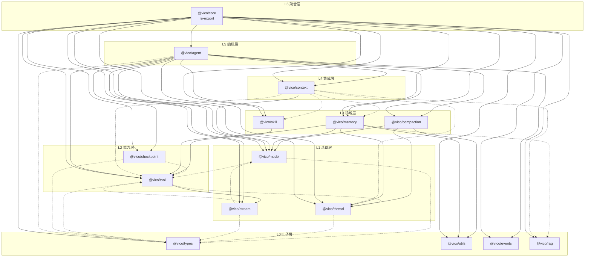

# @vico/core 包依赖关系分析

> 范围：`@vico/core` 拆分后的 13 个子包 + 聚合壳。边由各包源码的 `import` 归并到包粒度得出。
>
> 图例：**实线** = 运行时值依赖（`import` 值 / 函数 / 类 / const）；**虚线** = 仅类型依赖（`import type` 或纯 `interface`/`type` 引用，编译期擦除）。

## 依赖图

> 上图为 mermaid 源码渲染产物（`deps.svg`）；下方保留源码，可在 mermaid.live / GitHub 中直接编辑。

## 分层表

| 层 | 包 | 出边（依赖谁） |
|----|------|----------------|
| **L0 叶子** | `types` | —（纯结构契约） |
| | `utils` | —（Stack / KeyedMutex / map） |
| | `events` | —（事件记录） |
| | `rag` | —（RAG 检索 / 嵌入，既有包） |
| **L1 基础** | `model` | 值 → `ai`/providers；类型 → `types`、`tool` |
| | `thread` | 值 → `ai`；类型 → `types` |
| | `stream` | 值 → `ai`/provider；类型 → `types`、`tool`、`model` |
| **L2 能力** | `tool` | 值 → `stream`（toolResultPart）；类型 → `stream`、`thread`、`types` |
| | `checkpoint` | 类型 → `types`、`tool` |
| **L3 领域** | `skill` | 值 → `tool` |
| | `compaction` | 值 → `model`、`thread`、`utils` |
| | `memory` | 值 → `model`、`thread`、`tool`、`utils`；类型 → `rag` |
| **L4 集成** | `context` | 值 → `model`；类型 → `memory`、`rag`、`skill`、`thread`、`tool` |
| **L5 编排** | `agent` | 值 → `events`、`model`、`thread`、`stream`、`tool`、`skill`、`checkpoint`、`compaction`、`memory`、`context`；类型 → `types` |
| **L6 聚合** | `core` | 值 → 全部 13 个子包（纯 re-export） |

## 关键结论

1. **无运行时环**：唯一的 value 环疑点是 `model → tool → stream → model`，但其中只有 `tool → stream`（`toolResultPart`）是 value 边，其余 `model → tool`、`stream → model`、`stream → tool` 均为 `import type`，编译期擦除后运行时是 DAG。
2. **`agent` 不再是唯一 hub**：任何域包（tool / thread / memory 等）都可独立复用，不再间接经过 agent 编排层。
3. **`tool → agent` 运行时环已消除**：`createDelegateTool` 移入 `@vico/agent`，`@vico/tool` 成为可独立复用的通用工具包。
4. **pnpm 元数据环放行**：pnpm 无法区分 type/value，故在 `pnpm-workspace.yaml` 设 `ignoreWorkspaceCycles: true` 放行上述 type-only 环（任务产物无依赖，顺序无关紧要）。
