# @vico 包依赖关系分析

> 范围：workspace 下全部 24 个包（5 叶子 + 4 基础 + 4 领域 + 1 集成 + 1 编排 + 1 装配 + 8 域-存储适配器）。
> 边由各包 `src` 的 `import` 归并到包粒度得出，并借助 TypeScript TypeChecker 精确区分 value/type。
>
> 图例：**实线** = 运行时值依赖（`import` 值 / 函数 / 类 / const）；**虚线** = 仅类型依赖（`import type` 或纯 `interface`/`type` 引用，编译期擦除）。

## 依赖图

> mermaid 源码，GitHub / IDE 可直接渲染。同一包对若同时存在值依赖与类型依赖，仅画实线（值依赖已隐含类型可见）。

```mermaid
flowchart TD
    subgraph L5["L5 装配层"]
        boot["@vico/boot"]
    end
    subgraph L4["L4 编排层"]
        agent["@vico/agent"]
    end
    subgraph L3["L3 集成层"]
        context["@vico/context"]
    end
    subgraph AD["适配器层（域-存储）"]
        checkpoint_libsql["@vico/checkpoint-libsql"]
        checkpoint_mysql["@vico/checkpoint-mysql"]
        memory_libsql["@vico/memory-libsql"]
        memory_mysql["@vico/memory-mysql"]
        thread_libsql["@vico/thread-libsql"]
        thread_mysql["@vico/thread-mysql"]
        rag_chroma["@vico/rag-chroma"]
        rag_libsql["@vico/rag-libsql"]
    end
    subgraph L2["L2 领域层"]
        checkpoint["@vico/checkpoint"]
        skill["@vico/skill"]
        compaction["@vico/compaction"]
        memory["@vico/memory"]
    end
    subgraph L1["L1 基础层"]
        model["@vico/model"]
        thread["@vico/thread"]
        stream["@vico/stream"]
        tool["@vico/tool"]
    end
    subgraph L0["L0 叶子层"]
        types["@vico/types"]
        utils["@vico/utils"]
        events["@vico/events"]
        di["@vico/di"]
        rag["@vico/rag"]
    end

    %% ---- L1 → L0 ----
    model --> types
    model -.-> tool
    thread -.-> types
    stream -.-> model
    stream -.-> tool
    stream -.-> types
    tool -.-> thread
    tool -.-> types

    %% ---- L2 领域层 ----
    checkpoint -.-> tool
    checkpoint -.-> types
    skill --> tool
    compaction --> model
    compaction --> thread
    compaction --> utils
    memory --> model
    memory --> thread
    memory --> tool
    memory --> utils
    memory -.-> rag

    %% ---- L3 集成层（仅 model 为值依赖，其余端口为类型注入）----
    context --> model
    context -.-> memory
    context -.-> rag
    context -.-> skill
    context -.-> thread
    context -.-> tool

    %% ---- L4 编排层 ----
    agent --> checkpoint
    agent --> compaction
    agent --> context
    agent --> events
    agent --> memory
    agent --> model
    agent --> skill
    agent --> stream
    agent --> thread
    agent --> tool
    agent -.-> types

    %% ---- 域-存储适配器 ----
    checkpoint_libsql --> checkpoint
    checkpoint_mysql --> checkpoint
    memory_libsql --> memory
    memory_mysql --> memory
    thread_libsql -.-> thread
    thread_mysql -.-> thread
    rag_chroma -.-> rag
    rag_libsql -.-> rag

    %% ---- L5 装配层 ----
    boot --> agent
    boot --> checkpoint
    boot --> checkpoint_libsql
    boot --> checkpoint_mysql
    boot --> di
    boot --> events
    boot --> memory
    boot --> memory_libsql
    boot --> rag
    boot --> rag_chroma
    boot --> rag_libsql
    boot --> thread
    boot --> thread_libsql
    boot --> thread_mysql
    boot -.-> skill
    boot -.-> stream
```

## 分层表

| 层 | 包 | 出边（依赖谁） |
|----|------|----------------|
| **L0 叶子** | `types` | —（结构契约 + `SESSION_SCOPE_REASON` 常量） |
| | `utils` | —（KeyedMutex 等） |
| | `events` | —（事件记录） |
| | `di` | —（依赖注入容器） |
| | `rag` | —（嵌入器 / 向量存储接口 + InMemory 实现） |
| **L1 基础** | `model` | 值 → `types`；类型 → `tool` |
| | `thread` | 类型 → `types` |
| | `stream` | 类型 → `model`、`tool`、`types` |
| | `tool` | 类型 → `thread`、`types` |
| **L2 领域** | `checkpoint` | 类型 → `tool`、`types`（零值依赖） |
| | `skill` | 值 → `tool` |
| | `compaction` | 值 → `model`、`thread`、`utils` |
| | `memory` | 值 → `model`、`thread`、`tool`、`utils`；类型 → `rag` |
| **L3 集成** | `context` | 值 → `model`；类型 → `memory`、`rag`、`skill`、`thread`、`tool` |
| **L4 编排** | `agent` | 值 → `checkpoint`、`compaction`、`context`、`events`、`memory`、`model`、`skill`、`stream`、`thread`、`tool`；类型 → `types` |
| **适配器** | `checkpoint-libsql` / `-mysql` | 值 → `checkpoint`（迁移 + 版本常量） |
| | `memory-libsql` / `-mysql` | 值 → `memory`（模板 + 常量） |
| | `thread-libsql` / `-mysql` | 类型 → `thread`（仅接口） |
| | `rag-chroma` / `rag-libsql` | 类型 → `rag`（仅接口） |
| **L5 装配** | `boot` | 值 → `agent`、`checkpoint`、各存储适配器、`di`、`events`、`memory`、`rag`、`thread`；类型 → `skill`、`stream` |

> 备注：`memory-mysql` 当前无任何 workspace 内引用（`boot` 的 semantic 后端仅接线 `memory-libsql`），属预留适配器。

## 关键结论

1. **无运行时环、无类型环**：value 边严格沿 L0→L1→L2→L3→L4→L5 单向流动；type 边（`stream → model/tool`、`model → tool`、`tool → thread`、各适配器 → 域包）同样构成 DAG。原「`model → tool → stream → model`」疑点已不存在——`tool` 不再反向依赖 `stream`。
2. **`tool → stream` 值边已消除**：`toolResultPart` 等 part 构造器移入 `@vico/stream`，`@vico/tool` 退化为仅类型依赖 `thread`/`types` 的通用工具包，可独立复用。
3. **`agent` 不再是唯一 hub**：任何域包（tool / thread / memory / checkpoint / context 等）都可独立复用，不再间接经过 agent 编排层。
4. **`boot` 取代原 `@vico/core` 聚合壳**：作为装配层通过 DI 容器（`@vico/di`）接线各领域服务与存储后端，存储后端选择由 `storage` 配置段驱动。
5. **无需 pnpm 循环放行**：value / type / package.json 声明三层均无循环依赖，故 `pnpm-workspace.yaml` 不再需要 `ignoreWorkspaceCycles`。
