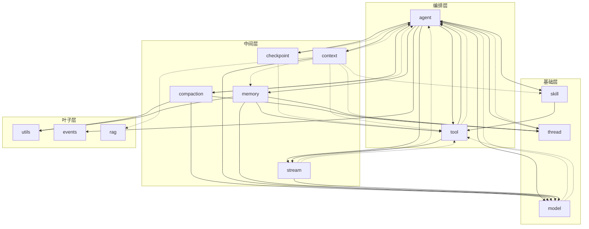

# @vico/core 模块依赖关系分析

> 范围：`packages/core/src` 下的顶层模块。边由各文件的 `import` 归并到模块粒度得出。
>
> 图例：**实线** = 运行时值依赖（`import` 值 / 函数 / 类 / const）；**虚线** = 仅类型依赖（`import type` 或纯 `interface`/`type` 引用，编译期擦除）。

## 依赖图

> 上图为 mermaid 源码渲染产物（`deps.svg`）；下方保留源码，可在 mermaid.live / GitHub 中直接编辑。

## 分层表

| 层 | 模块 | 出边（依赖谁） |
|----|------|----------------|
| **编排** | `agent` | 运行时依赖全部 10 个模块（LoopAgent 编排核心） |
| | `tool` | 运行时 → `agent`(delegate-tool 的 `createAgent`)、`stream` |
| **中间** | `checkpoint` | 仅类型 → `agent`、`tool` |
| | `compaction` | 运行时 → `model`、`thread`、`utils`；类型 → `agent` |
| | `context` | 运行时 → `model`；类型 → `agent`/`memory`/`rag`/`skill`/`thread`/`tool` |
| | `stream` | 运行时 → `model`；类型 → `agent`、`tool` |
| | `memory` | 运行时 → `model`、`thread`、`tool`、`utils` |
| **基础** | `model` | 仅类型 → `agent`、`tool` |
| | `thread` | 仅类型 → `agent` |
| | `skill` | 运行时 → `tool` |
| **叶子** | `utils` / `events` / `rag` | 无内部出边 |

## 关键发现

1. **唯一真正的运行时循环：`agent ↔ tool`**
   - `agent → tool`：`loop-agent.ts` 运行时引入 `ToolExecutor`、`composeResolvers`。
   - `tool → agent`：`tool/builtin/coding/delegate-tool.ts` 运行时引入 `createAgent`（子代理需要再建 Agent）。
   - 这是真实的值级双向依赖，可编译但运行时行为需留意（ESM 循环引用）。

2. **`agent` 是「类型引力中心」**：几乎所有模块都反向 `import type` 到 `agent/types.ts` / `agent/loop-agent-options.ts`（`TurnContext`、`TurnSession`、`ToolCallApproval` 等）。虚线边编译期擦除，安全，但结构上让 `agent` 成为全局耦合点。

3. **已消除的语义噪音**：以下纯类型引用已改为 `import type`，避免伪装成运行时依赖：
   - `src/tool/types.ts` → `import type {ToolCallApproval, TurnSession}`
   - `src/context/model-request-context.ts` → `import type {TurnSession, TurnStep}`

4. `index.ts`（barrel）是唯一对外出口，重导出全部模块，自身不参与上述依赖环。
