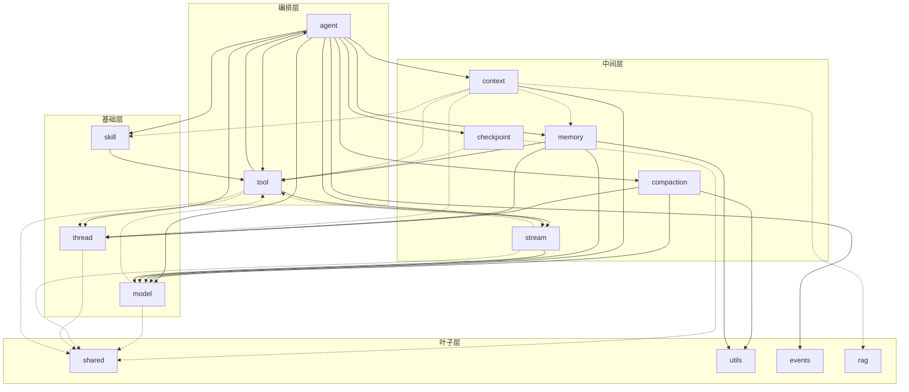

# @vico/core 模块依赖关系分析

> 范围：`packages/core/src` 下的顶层模块。边由各文件的 `import` 归并到模块粒度得出。
>
> 图例：**实线** = 运行时值依赖（`import` 值 / 函数 / 类 / const）；**虚线** = 仅类型依赖（`import type` 或纯 `interface`/`type` 引用，编译期擦除）。

## 依赖图

> 上图为 mermaid 源码渲染产物（`deps.svg`）；下方保留源码，可在 mermaid.live / GitHub 中直接编辑。

## 分层表

| 层 | 模块 | 出边（依赖谁） |
|----|------|----------------|
| **编排** | `agent` | 运行时依赖全部 10 个模块（LoopAgent 编排核心） |
| | `tool` | 运行时 → `agent`(delegate-tool 的 `createAgent`)、`stream`；类型 → `shared`、`thread` |
| **中间** | `checkpoint` | 类型 → `shared`、`tool` |
| | `compaction` | 运行时 → `model`、`thread`、`utils` |
| | `context` | 运行时 → `model`；类型 → `memory`/`rag`/`skill`/`thread`/`tool` |
| | `stream` | 运行时 → `model`；类型 → `shared`、`tool` |
| | `memory` | 运行时 → `model`、`thread`、`tool`、`utils` |
| **基础** | `model` | 类型 → `shared`、`tool` |
| | `thread` | 类型 → `shared` |
| | `skill` | 运行时 → `tool` |
| **叶子** | `shared` | 无出边（`UsageMetrics` / `ToolCallApproval` / `ToolApproval` 纯结构类型） |
| | `utils` / `events` / `rag` | 无出边 |

## 关键发现

1. **「类型引力中心」已消除**：所有非 agent 模块不再 `import type` agent。此前集中在 `agent/types.ts` / `agent/loop-agent-options.ts` 的共享类型已下沉：
   - `UsageMetrics` / `ToolCallApproval` / `ToolApproval` → **`src/shared.ts`**（新叶子）
   - `ModelConfig` / `ModelRef` / `isLanguageModelV4` → `model/types.ts`
   - `TurnEvent` / `CallModelResult` → `stream/types.ts`
   - `TurnSession` / `TurnStep` → `thread/thread-store.ts`

2. **唯一真正的运行时循环仍是 `agent ↔ tool`**：
   - `agent → tool`：`loop-agent.ts` 运行时引入 `ToolExecutor`、`composeResolvers`。
   - `tool → agent`：`tool/builtin/coding/delegate-tool.ts` 运行时引入 `createAgent`（子代理需要再建 Agent）。
   - 其余 tool → agent 的 type 引用已用**依赖倒置**消除：`ToolExecutor` 改用本地窄接口 `AgentHost`（`emit`）与 `ToolExecutionContext`（`session`/`signal`/`decisions`/`controller`），引擎的 `LoopAgent` / `TurnContext` 结构化满足。

3. **`shared` 是新的类型叶子**：被 `checkpoint` / `context` / `model` / `stream` / `thread` / `tool` 六个模块依赖，自身无出边，避免了 `thread → model → tool → thread` 这类 type 环。

4. `index.ts`（barrel）是唯一对外出口，重导出全部模块，自身不参与上述依赖环；对外导出的符号名未变，消费方零改动。
