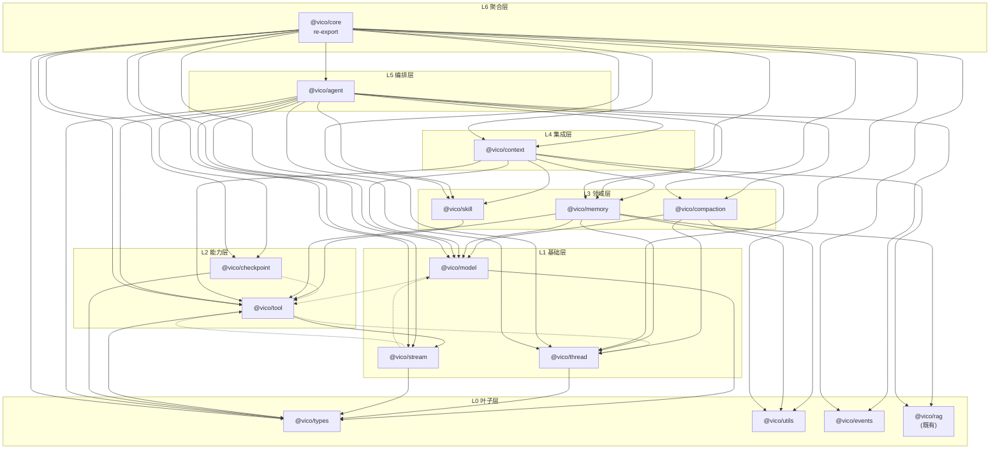

# @vico/core 拆分方案

> 目标：把单一 `@vico/core` 打散为按语义域划分的子 package，消除 agent 星型耦合与 `agent ↔ tool` 运行时环，让每个域可被独立复用；`@vico/core` 保留为聚合壳，消费方零改动。

## 一、现状问题

1. **agent 是唯一 hub**：`agent` 运行时依赖全部 10 个模块，任何域想复用都必须间接经过 agent 的编排逻辑。
2. **`tool → agent` 运行时环**：`tool/builtin/coding/delegate-tool.ts` 静态 `import { createAgent }`，导致最通用的工具包反向依赖编排层。
3. **复用粒度太粗**：`@vico/server` 想用工具框架，必须拖入 agent、记忆、压缩、Skill 全部代码。

## 二、子包清单

按依赖层次由底到顶，共 **12 个新子包 + `@vico/core` 聚合壳 = 13 包**：

| 层 | 包名 | 来源 | 职责 |
|----|------|------|------|
| L0 叶子 | `@vico/types` | `shared.ts` | **基础数据契约**（跨域共享的纯结构类型） |
| L0 叶子 | `@vico/utils` | `utils/` | Stack、KeyedMutex、map 工具 |
| L0 叶子 | `@vico/events` | `events/` | 事件记录（MittEventRecorder） |
| L1 基础 | `@vico/model` | `model/` | 模型工厂、ModelClient、消息工具 |
| L1 基础 | `@vico/thread` | `thread/` | 线程/会话存储（含内存实现） |
| L1 基础 | `@vico/stream` | `stream/` | 流式解析、用量、事件 |
| L2 能力 | `@vico/tool` | `tool/`（**除** delegate-tool） | 工具框架 + 内置工具 |
| L2 能力 | `@vico/checkpoint` | `checkpoint/` | 检查点（断点续传） |
| L3 领域 | `@vico/skill` | `skill/` | Skill 加载/注册/工具 |
| L3 领域 | `@vico/compaction` | `compaction/` | 上下文压缩 |
| L3 领域 | `@vico/memory` | `memory/` | 双层记忆 + 会话历史 |
| L4 集成 | `@vico/context` | `context/` | 上下文洋葱模型处理器 |
| L5 编排 | `@vico/agent` | `agent/` + delegate-tool | Agent 编排核心 |
| L6 聚合 | `@vico/core` | 原 `index.ts` | 纯 re-export 聚合壳 |

> 既有 `@vico/rag` 不动；`core/src/rag/types.ts` 的 `RagChunk` / `RagProvider` 检索端口并入 `@vico/rag`。

## 三、类型归属（关键：`@vico/types` 只承载基础类型）

**原则：`@vico/types` 只放跨域共享的基础数据契约，域类型一律留在各自域包。** type-only 依赖在编译期擦除，不构成运行时环，因此无需为消灭 type 环而把域类型塞进 types。

| 类型 | 归属 | 说明 |
|------|------|------|
| `UsageMetrics` / `ToolCallApproval` / `ToolApproval` | **`@vico/types`** | 现 `shared.ts` 的跨域基础契约 |
| `Tool` / `ToolCall` / `ToolResult` / `ToolPolicy` / `ToolKind` / `ToolTag` / `ToolCallContext` / `Approval*` / `PolicyContext` / `ApprovalResolver` / `ApprovalDecider` | `@vico/tool` | tool 领域类型 |
| `Thread` / `ThreadMetadata` / `Turn` / `TurnSession` / `TurnStep` / `Message` / `ThreadStore` 等 | `@vico/thread` | thread 领域类型 |
| `TurnEvent` / `CallModelResult` / `UserMessage` | `@vico/stream` | stream 领域类型 |
| `RagChunk` / `RagProvider` | `@vico/rag` | RAG 检索端口 |

## 四、拆完后的依赖关系

依赖方向：**只能从高层指向低层**；虚线为 `import type`（运行时擦除）。

| 包 | 依赖（内部） |
|----|-------------|
| `@vico/types` | — |
| `@vico/utils` | — |
| `@vico/events` | — |
| `@vico/model` | `types`；type → `tool`（Tool/ToolCall/ToolResult） |
| `@vico/thread` | `types` |
| `@vico/stream` | `types`；type → `tool`（ToolCall/ToolResult）、`model`（ModelRequest） |
| `@vico/tool` | `types`；**value → `stream`（toolResultPart）**；type → `stream`（TurnEvent）、`thread`（TurnSession） |
| `@vico/checkpoint` | `types`；type → `tool`（ToolCall/ToolResult） |
| `@vico/skill` | `tool` |
| `@vico/compaction` | `model`、`thread`、`utils` |
| `@vico/memory` | `model`、`thread`、`tool`、`utils`、`rag` |
| `@vico/context` | `model`、`memory`、`skill`、`thread`、`tool`、`rag` |
| `@vico/agent` | `types`、`events`、`model`、`thread`、`stream`、`tool`、`skill`、`checkpoint`、`compaction`、`memory`、`context`（不依赖 `utils`/`rag`） |
| `@vico/core` | 以上全部 13 个（纯 re-export） |

**关键结论**：

1. `agent` 不再是唯一 hub，而是 L5 收口层——它依赖所有下层，但**没有任何包反向依赖它**（运行时）。
2. `tool → agent` 环消除：`@vico/tool` 变成可独立复用的通用工具包。
3. `model → tool → stream → model` 在 package.json 图上构成环，但其中只有 `tool → stream`（`toolResultPart`）是运行时 value 边，其余（`model → tool`、`stream → model`、`stream → tool`）均为 `import type`，编译期擦除后**运行时无环**。pnpm 无法区分 type/value，故在 `pnpm-workspace.yaml` 设 `ignoreWorkspaceCycles: true` 放行。

## 五、关键决策

### 5.1 delegate-tool 移出 `@vico/tool`（打破运行时环）

`createDelegateTool` 本质是「创建子 agent」的 agent 能力，不是通用工具，且当前**无任何业务调用方**（仅 barrel 导出）。

- 文件 `tool/builtin/coding/delegate-tool.ts` → 移到 `@vico/agent`（如 `agent/tools/delegate-tool.ts`）。
- `createDelegateTool` 的**公开签名与导出符号不变**，仅 barrel 导出源从 `tool/builtin/index.js` 改为 agent 侧。
- 结果：`@vico/tool` 不再依赖 agent。

### 5.2 `@vico/core` 保留为聚合壳（消费方零改动）

- `@vico/core/src/index.ts` 改为对 13 个子包的 `export * from '@vico/xxx'`。
- 导出符号集合与现在完全一致 → `@vico/server`、`@vico/web`、`@vico/libsql-adapter` 零改动。
- 新复用方可以只依赖细粒度子包。

### 5.3 包结构沿用现有模式

- `package.json`：`"type": "module"`、`"exports": { ".": "./src/index.ts" }`、`private: true`、`workspace:*` 依赖
- `tsconfig.json`：NodeNext + `rootDir: src` + `outDir: dist` + declaration
- 跨包 import 用包名 `@vico/xxx`；**包内** import 保持相对路径 `.js`
- `turbo.json` 的 `build.dependsOn: ["^build"]` 自动按依赖拓扑排序；pnpm workspace 自动 link

## 六、迁移步骤（分阶段，每步 `tsc` + `vitest` 绿灯再进下一步）

1. **Phase 1 — 建 `@vico/types`（仅 shared.ts）**：`UsageMetrics` / `ToolCallApproval` / `ToolApproval` 迁入，删 `shared.ts`，所有 `../shared.js` 引用改 `@vico/types`。
2. **Phase 2 — 自底向上迁移实现**：`model / thread / stream` → `tool / checkpoint` → `skill / compaction / memory` → `context` → `agent`，逐包建目录、移动文件、改跨包 import。
3. **Phase 3 — delegate-tool 归位**：移入 `@vico/agent`，`@vico/tool` 移除对 agent 的 import。
4. **Phase 4 — `@vico/core` 改聚合壳**：index.ts 改 re-export，跑 `@vico/server` / `@vico/web` / `@vico/libsql-adapter` 的 tsc 确认零改动。
5. **Phase 5 — 收尾**：删除 `packages/core/dist` 陈旧产物、更新 `DEPENDENCIES.md` 与 `deps.svg`。

## 七、消费方影响

| 消费方 | 改动 |
|--------|------|
| `@vico/server` | 无（仍 `import from '@vico/core'`） |
| `@vico/web` | 无 |
| `@vico/libsql-adapter` / `@vico/mysql-adapter` | 无 |
| 新复用方 | 可选细粒度依赖 `@vico/tool` / `@vico/memory` / `@vico/model` 等 |

## 八、可合并的保守变体（8 包）

若觉得 13 包过碎，可把低复用域并入 agent：

- `checkpoint` / `compaction` / `context` / `events` / `utils` → 并入 `@vico/agent`
- 只保留 `@vico/types` / `@vico/model` / `@vico/thread` / `@vico/stream` / `@vico/tool` / `@vico/skill` / `@vico/memory` 七个独立子包 + `@vico/core`
